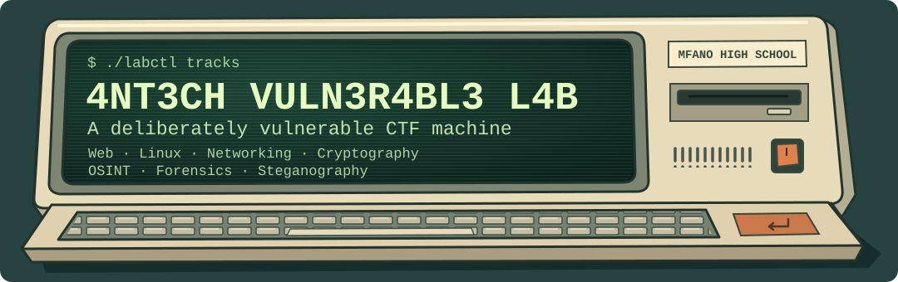

<p align="center">
  
</p>

<p align="center">
  
  
  
  
  
  
  
  
</p>

> [!CAUTION]
> **This lab has security holes on purpose. Never deploy it on a public server.**
> Run it on your own machine only. If you must reach it from another device, put
> it behind Tailscale or Cloudflare Access so that only you can get in.

**Mfano High School Portal** is a made-up Kenyan secondary school portal. Students
check marks and download report forms, the bursar takes M-Pesa-style fee
payments, and the admin runs the server tools. Hidden inside are web bugs from the
[OWASP Top 10:2025](https://top10.owasp.org/2025/), a few network
misconfigurations, and a box of forensics evidence. Each one gives up a
`MFANO{...}` flag when you exploit it. The flags are scored offline by `labctl`,
a Linux Bash CLI with full-screen menus for submissions, progress, and gentle clues.

*Mfano* means "example" in Swahili. Every student, mark, fee balance and payment is
fake, and the lab never calls a real payment API.

## Contents

- [What you will practise](#what-you-will-practise)
- [Requirements](#requirements)
- [Install and run](#install-and-run)
  - [Option 1: labctl menu — recommended default](#option-1-labctl-menu-recommended-default)
  - [Option 2: direct Compose commands — backup](#option-2-direct-compose-commands-backup)
- [Log in](#log-in)
- [Your first exercises](#your-first-exercises)
- [Stop and return later](#stop-and-return-later)
- [Find and submit flags](#find-and-submit-flags)
- [The challenges](#the-challenges)
- [labctl reference](#labctl-reference)
- [Run the tests](#run-the-tests)
- [Troubleshooting](#troubleshooting)
- [Project layout](#project-layout)
- [Safety rules](#safety-rules)
- [About](#about)

## What you will practise

| Track | Skills |
| ----- | ------ |
| Web | Access control, injection, broken auth and sessions, login discovery and brute forcing, file upload, SSRF, business logic |
| Linux | Reading, writing, filtering and combining files; chmod, chown, chgrp; hidden and unusual filenames, file types, find filters, sort and uniq |
| Networking | Port and service discovery with `nmap`, weak database credentials |
| Secrets and supply chain | Secrets in frontend code and git history, vulnerable dependencies, leaky errors |
| Cryptography | Cracking weak password hashes, spotting fake "encryption", forging weakly-signed tokens, hardcoded keys, ECB structure leaks |
| Integrity and design | Insecure deserialization, mass assignment, secrets leaking into exposed logs |
| Social engineering | OSINT password profiling, spotting phishing, and pretexting — all against fake NPCs in the lab |
| Forensics | Image metadata, file carving, LSB steganography, GIF frames, Morse, spectrograms, video frames |

## Requirements

| What you need | Why |
| --- | --- |
| Kali Linux, Debian 12 or newer, or Ubuntu 22.04 or newer | These steps and the challenge menu run on Linux |
| Internet for the first setup | Download the project, tools, and practice environments |
| Your Linux administrator password | Install the tools with `sudo` |
| About 5 GB of free disk space | Leave room for the project and Docker downloads |

You do not need programming or Docker experience. The steps below install the
tools you need. Git downloads the project; Python prepares the first text
exercises; Docker runs the web lab and the later Linux sandboxes. Extra tools
for particular challenges are listed with their track guides.

## Install and run

Complete steps 1–3 once, then choose one of the two ways to start the web lab.
**Option 1 is the default for beginners. Option 2 is the backup.**

### Before you begin

Open the **Terminal** application in your Linux desktop. A terminal is the
window where you type commands. Copy the commands inside each code block, press
Enter, and wait for the prompt to return before continuing. You can usually
paste with Ctrl+Shift+V or the terminal's right-click menu.

`sudo` may ask for your Linux password. Nothing appears while you type it;
type the password and press Enter. This is normal.

If your computer uses Windows or macOS, use a Linux computer or a Linux virtual
machine first. A virtual machine is a separate Linux desktop running in a
window; see the [official Kali VM guides](https://www.kali.org/docs/virtualization/).
Run these commands and open the lab's browser **inside that Linux desktop**.

### 1. Install the basic tools

Run these commands in the Linux terminal:

```sh
sudo apt update
sudo apt install -y git python3 bash jq whiptail coreutils util-linux grep less make
```

Wait until both commands finish successfully. `jq` and `whiptail` provide the
scoring and menu tools. You will use Python only for the offline file exercises;
the web application's programs are supplied by Docker.

### 2. Download the project (clone)

```sh
cd ~
git clone https://github.com/Antech-greyhat/VulnHub.git
cd VulnHub
```

`cd ~` goes to your home folder. `git clone` downloads the project into a new
folder named `VulnHub`; `cd VulnHub` enters it. This is a public project, so
cloning does not require a GitHub account or password.

You are now in the **project folder**. Later commands such as `./labctl` start
a program in this folder; the `./` is part of the command. If you already cloned
the project here, keep that copy and use `cd ~/VulnHub` to return to it. If your
existing copy is elsewhere, use that folder instead of `~/VulnHub` throughout
these guides.

### 3. Set up Docker once

Docker runs the practice environments in **containers**, which are separate
Linux environments for the lab. **Compose** starts the web portal and its
supporting services together. If Docker and Compose already work on your
machine, keep that installation and continue with the ready check below.

For a fresh setup, install Docker:

```sh
sudo apt install -y docker.io
```

Then copy **one** Compose installation command for your Linux system:

| Your Linux system | Command to copy |
| --- | --- |
| Kali or Debian | `sudo apt install -y docker-compose` |
| Ubuntu | `sudo apt install -y docker-compose-v2` |

Start Docker and allow your Linux account to use it:

```sh
sudo systemctl enable --now docker
sudo usermod -aG docker "$USER"
```

**Log out of your Linux desktop, then log back in.** This applies the new
Docker group membership. Open a new terminal and return to the project:

```sh
cd ~/VulnHub
docker info
./labctl --no-color doctor
```

`docker info` should show both **Client** and **Server** information.
The lab check should report **61 challenges registered** and end with **Ready.**
Tools marked optional can be installed when you reach the relevant challenge.
The lab check verifies scoring; `docker info` separately checks the Docker
service. If either check fails, use [Troubleshooting](#troubleshooting) below.

### 4. Choose how to start the web lab

Both options start the same web portal, internal grading service, and practice
backup database. The menu automatically chooses the installed Compose command.
Linux exercise launch commands are listed under [Your first exercises](#your-first-exercises).

#### Option 1: labctl menu (recommended default)

From the project folder, run:

```sh
./labctl
```

The challenge menu opens. Use the arrow keys to select an item, Tab to move
between controls, and Enter to confirm.

1. Choose **Manage lab services**.
2. Choose **Build and start containers**.
3. Wait for it to finish. The first build downloads programs and can take several
   minutes; the menu may look idle while it works.
4. Read the result, select **OK**, and return with **Main menu**.

You can use this same menu to browse challenges, read clues, submit flags, and
stop the web lab. Maximize the terminal if a menu does not fit.

#### Option 2: direct Compose commands (backup)

Use this if the menu will not open, or if you need to see the build output
directly. From `~/VulnHub`, copy the block matching your Compose installation.

**Ubuntu, or an existing installation with `docker compose`:**

```sh
docker compose up -d --build
docker compose ps
```

**Kali or Debian using `docker-compose`:**

```sh
docker-compose up -d --build
docker-compose ps
```

`up` starts the services, `--build` prepares their programs, and `-d` leaves them
running in the background. Wait for the first command to finish. The second
lists the services: look for **web**, **grading**, and **backupdb** running.
You can still use `./labctl` to browse challenges and record your score.

### 5. Open the web lab

Open your web browser and enter this exact address in its address bar:

**<http://127.0.0.1:8080>**

You should see the Mfano login page. If you use a Linux VM, open its browser
inside the VM too. A newly started service can need a few seconds; refresh the
page once if needed. The sample login details are below.

## Log in

| Role | Username | Password |
| ---- | -------- | -------- |
| Student | `MHS1007` | `Student@123` |
| Admin | `admin` | `Mfano@Admin2026` |

Every student from `MHS1001` to `MHS1030` uses the same demo password. The admin
login is there so you can look around. Hacking your way to admin from a student
account counts for more.

## Your first exercises

Begin with the Linux tracks in this order. Run each start command in a normal
Linux terminal from `~/VulnHub` when you reach that track, and open its guide
for the tasks.

| Order | Track | Start command | Guide |
| --- | --- | --- | --- |
| 1 | File manipulation, FM-01 to FM-08 | `python3 -B linux-files/lab.py prepare` | [File exercises](linux-files/README.md) |
| 2 | Permissions and ownership, FO-01 to FO-07 | `./linux-ownership/lab` | [Ownership exercises](linux-ownership/README.md) |
| 3 | File discovery, LD-01 to LD-07 | `./linux-discovery/lab` | [Discovery exercises](linux-discovery/README.md) |
| 4 | Web and network challenges, starting at P1 | Start the web lab with option 1 or 2 above | [Challenge list](#the-challenges) |

Prepare the file exercises once; later sessions use the existing files in
`var/linux-files/`. You can practise those before starting the web services.

Your **host terminal** is the normal Linux terminal where you cloned the
project. Ownership and discovery launchers open a **sandbox shell** with a
prompt beginning `(Mfano sandbox)` or `(Mfano discovery)`. Work on those tasks
inside their sandbox. Keep it open, then open a second host terminal to submit:

```sh
cd ~/VulnHub
./labctl submit FO-01
```

Use the ID of the task you completed, such as FM-01, FO-01, or LD-01. Paste
the flag into the hidden box. The [submission guide](#find-and-submit-flags)
explains flags and progress. `labctl` runs on the host; each track guide shows
how to find or check its flag inside the exercise.

## Stop and return later

**To stop the web lab with the menu**, open `./labctl`, choose **Manage lab
services**, then **Stop containers**. Choose **Exit** from the main menu when
you are done. Closing only the browser or the menu leaves the web containers
running in the background.

**To stop it with the backup commands**, use the same Compose spelling you
used to start it:

```sh
docker compose down
```

Or, for the Kali/Debian `docker-compose` installation:

```sh
docker-compose down
```

**To leave an ownership or discovery sandbox**, type `exit` inside it. Its
practice changes are discarded, so submit each earned flag before leaving.
Your submitted score stays in `.labprogress.json` in the project folder.

**Next time**, open a Linux terminal and run:

```sh
cd ~/VulnHub
./labctl
```

Start the web lab through the menu again, or repeat the backup start command.
Docker reuses its previous downloads. For a Linux track, return to its existing
file workspace or run its sandbox launcher again. You only clone and install
the tools once.

To get project updates, run `git pull` from `~/VulnHub`, then build/start again.
If you need fresh mock school records while the web lab is running, preview
and confirm a reset:

```sh
./labctl reset --dry-run
./labctl reset
```

Reset changes the portal's mock records; your submitted flag progress is kept.

## Find and submit flags

Every flag is the word `MFANO`, then short words in **leetspeak** inside curly
braces, joined by underscores:

```text
MFANO{c4n_h4ck_f0r_r34l}
```

| Plain letter | a | e | i | o | s (sometimes) |
| ------------ | - | - | - | - | ------------- |
| In a flag | `4` | `3` | `1` | `0` | `5` |

Copy a flag exactly as you find it. Don't translate it back to plain English. A
plain-English guess like `MFANO{can_hack_for_real}` will be rejected as a
`wrong flag`.

1. **Hunt.** Complete a Linux exercise in [`linux-files/`](linux-files/README.md),
   [`linux-ownership/`](linux-ownership/README.md), or
   [`linux-discovery/`](linux-discovery/README.md). You can also exploit a bug in
   the portal or pull a secret out of a forensics file. A real exploit makes
   the flag show up: in a page, a database row, a
   file on the box, a frame of video.
2. **Submit.** Open the menu, choose **Submit a flag**, then choose the track
   and challenge. Paste the exact flag into the hidden input box:

   ```sh
   ./labctl
   ```

   To submit directly to a known challenge, the command also opens a hidden box:

   ```sh
   ./labctl submit P1-01
   ```

   A correct flag updates the solved and remaining totals. A flag for another
   challenge is rejected for the selected ID. Submitting the same flag again
   won't count it twice. `./labctl submit P1-01 --dry-run` validates without recording.
3. **Track progress.**

   ```sh
   ./labctl status
   ./labctl solved
   ./labctl unsolved --track F
   ./labctl hints F-01
   ```

   The menu provides the same views, with challenge details and gentle clues.

How scoring works:

- `flags.sha256` holds only the **SHA-256 hash** of each flag. `labctl` hashes what
  you submit and compares the two, so reading the repo won't give you the answers.
- Your progress is saved in `.labprogress.json` in the repo folder, compatible
  with earlier progress files. Git ignores that file and its lock. If you choose
  to start scoring over, move your progress file to Trash: `gio trash -- .labprogress.json`.
- Corrupted progress is reported and preserved. Concurrent submissions are
  serialized so one solve cannot overwrite another.
- Flags found in pictures, audio or video are drawn or spoken in capitals, for
  example `MFANO{C4N_H4CK}`. Keep `MFANO` in capitals, but write the part inside
  the braces in **lowercase** and keep the digits: `MFANO{c4n_h4ck}`. In the
  pixel font, a zero has a slash through it and a one has a hook at the top.

## The challenges

There are 61 flags. The categories are listed below, but not where the bugs are.
`SCOREBOARD.md` has the per-phase breakdown.

| Stages | Theme | Count | Difficulty |
| ------ | ----- | ----- | ---------- |
| FM-xx | Linux file manipulation (start here) | 8 | Easy to Easy-Medium |
| FO-xx | Linux permissions and ownership | 7 | Easy to Easy-Medium |
| LD-xx | Linux file discovery (Bandit-inspired) | 7 | Easy to Easy-Medium |
| P1-xx | Web access control and Linux files | 3 | Easy |
| P2-xx | Networking and exposed services | 2 | Easy-Medium |
| P3-xx | Injection, XSS, sessions, privilege escalation | 4 | Medium |
| P4-xx | Server tools: chains that end in full control | 4 | Hard |
| P5-xx | Secrets, supply chain and error handling | 4 | Medium-Hard |
| P5B-xx | Weak cryptography: hashes, fake encryption, tokens, keys, ECB | 5 | Medium-Hard |
| P5D-xx | Integrity and design: deserialization, mass assignment, logged secrets | 3 | Medium |
| BF-xx | Web brute-force basics: discovery, request fields, login errors, hidden accounts | 4 | Easy-Medium |
| SE-xx | Social engineering: OSINT, phishing, pretexting (fake NPCs) | 3 | Easy-Medium |
| F-xx | Forensics: images, GIF, audio, video | 7 | Easy to Medium |

Start with [`linux-files/README.md`](linux-files/README.md) for eight guided
exercises covering `cat`, `echo`, `less`, `head`, `tail`, `tac`, `grep`, `wc`,
`paste`, and `join`. Their flags use the same menu and submission flow as the
existing challenges. Next, follow [`linux-ownership/README.md`](linux-ownership/README.md)
and run `./linux-ownership/lab` for seven `chmod`, `chown`, and `chgrp` exercises
in a Docker sandbox. The guide includes first-time Docker setup and explains
how to check, exit and submit on the host. Then run `./linux-discovery/lab` for
seven [file discovery exercises](linux-discovery/README.md) inspired by Bandit
levels 1–6 and 8. Reading and known-entry searching are already covered, so
levels 0 and 7 are skipped. The Linux tracks come first; existing IDs and saved
solves stay valid.

<details>
<summary><b>Networking notes</b></summary>

The lab publishes a few services on your loopback interface only:

```sh
sudo apt install -y nmap postgresql-client
nmap -sV 127.0.0.1
```

| Port | Service |
| ---- | ------- |
| 8080 | Web portal (Flask) |
| 5432 | PostgreSQL "results backup" database |

A small internal grading service also runs inside the Docker network. It isn't
published to your machine, so `nmap` from the host won't see it. Reaching it is
a later challenge.

</details>

<details>
<summary><b>Web brute-force notes</b></summary>

Four retired consoles teach a beginner workflow: discover pages, inspect browser
source and requests, recover an account, then test a small password wordlist.
The interface is intentionally plain. Read the spoiler-free
[`web-bruteforce/README.md`](web-bruteforce/README.md) for the practice sequence
and bundled wordlists. `./labctl labs --track BF` lists the exercises;
`./labctl hints BF-01` offers a gentle clue.

</details>

<details>
<summary><b>Supply-chain notes</b></summary>

One dependency is pinned to an old, known-vulnerable version on purpose. The
lesson is **detection**: find it, read the advisory, note the fixed version.

```sh
# Kali blocks system-wide pip installs, so use pipx or a virtualenv
sudo apt install -y pipx && pipx install pip-audit
./labctl audit
```

Never run an exploit against an external target.

</details>

<details>
<summary><b>Cryptography notes</b></summary>

Five challenges live on the running portal and each one is solved by **breaking**
the crypto, not by reading the source. You will want a wordlist and a few common
tools (all on Kali):

```sh
# password-hash and JWT-secret cracking
sudo apt install -y hashcat john
ls /usr/share/wordlists/rockyou.txt.gz && gunzip -k /usr/share/wordlists/rockyou.txt.gz
# base64 / AES by hand: CyberChef, or openssl / python / node one-liners
```

The lessons: encoding is not encryption, a key shipped to the browser is not a
secret, a guessable signing secret is forgeable, unsalted hashes fall to a
wordlist, and ECB mode leaks the structure of what it encrypts.

</details>

<details>
<summary><b>Social-engineering notes</b></summary>

Three awareness challenges live on the staff **Intranet** (in the student nav,
or `/intranet`). They are a safe sandbox:

- **Everyone is a fake NPC.** No real people, companies or brands.
- **Nothing sends a real message.** The webmail items are static samples and the
  helpdesk "bot" is a rule-based script that talks to nothing outside the lab.
- **No working phishing page, no credential capture.** You never type a real
  password anywhere; the fake sign-in only checks an invented NPC account.

What you practise: reading a person's public posts to profile a weak password
(OSINT), telling phishing from legitimate mail by sender/link/pressure, and
chaining small facts into a convincing pretext. No tools needed beyond the browser.

</details>

<details>
<summary><b>Forensics notes</b></summary>

The [`forensics/`](forensics/) folder holds seven evidence files from a leaked
mock exam. You don't need Docker for these. Read the case brief in
[`forensics/README.md`](forensics/README.md). On Kali, most of the tools are
already installed or one `apt install` away:

```sh
sudo apt install -y exiftool binwalk foremost ffmpeg audacity sonic-visualiser
sudo apt install -y ruby && sudo gem install zsteg
```

</details>

## labctl reference

| Command | What it does |
| ------- | ------------ |
| `./labctl` | Open the styled Linux menu |
| `./labctl tracks` / `./labctl labs` | Discover tracks and challenges |
| `./labctl submit P1-01` | Enter a hidden flag for the chosen challenge and record it |
| `./labctl submit P1-01 --dry-run` | Validate a flag without changing progress |
| `./labctl status` / `./labctl score` | Show every stage and progress |
| `./labctl solved` / `./labctl unsolved` | Show completed or remaining challenges |
| `./labctl hints F-01` | Read a gentle challenge clue |
| `./labctl --json doctor` | Check offline setup and data for scripts |
| `./labctl start` / `./labctl stop` | Build/start or stop the containers |
| `./labctl reset` | Confirm reseeding fresh mock data |
| `./labctl shell` | Open Bash inside the web container |
| `./labctl audit` | Scan `requirements.txt` with pip-audit |

See [`cli/README.md`](cli/README.md) for filters, JSON output, stdin submissions,
configuration, installation, and command previews. `./labctl --help` lists all commands.

## Run the tests

This is an optional section for contributors who edit the project. The tests
check that the lab is built correctly and **contain every flag**, so read them
only after you finish. Install the additional test tools first:

```sh
sudo apt install -y python3-venv python3-pip make shellcheck
python3 -m venv .venv
. .venv/bin/activate
pip install -r requirements.txt pytest
python -m pytest -q

# Bash syntax and ShellCheck, then the CLI checks alone
make check
make test

# With Docker running, solve the ownership and discovery tasks in real containers
MFANO_TEST_DOCKER=1 python -m pytest -q tests/test_linux_ownership.py tests/test_linux_discovery.py
```

## Troubleshooting

Run these checks in a normal **host terminal**. If you are inside an ownership
or discovery sandbox, submit any earned flags and type `exit` first.

| Problem | Fix |
| ------- | --- |
| `git: command not found` or `python3: command not found` | Complete [step 1](#1-install-the-basic-tools). |
| Clone says `destination path 'VulnHub' already exists` | Keep your existing copy. Run `cd ~/VulnHub`; continue setup there. |
| `./labctl: No such file or directory` | Run `cd ~/VulnHub`, then `ls`. You should see `labctl` and `README.md`; use the folder where you actually cloned the project. |
| `permission denied ... docker.sock` | Run `sudo usermod -aG docker "$USER"`, log out of Linux and back in, then retry `docker info`. |
| `Cannot connect to the Docker daemon` | Run `sudo systemctl start docker`, then `docker info`. |
| `Docker Compose was not found` or `compose is not a docker command` | Use the Compose installation command for your system in [step 3](#3-set-up-docker-once). The menu accepts either command spelling. |
| Required `jq` or `whiptail` is missing | Run `sudo apt install -y jq whiptail`. |
| Menu is too small or needs an interactive terminal | Open and maximize the Terminal app, then run `./labctl` directly. Use [option 2](#option-2-direct-compose-commands-backup) to start the web lab while fixing the menu. |
| First build appears idle or downloads fail | Allow a few minutes for downloads. If it reports an error, check internet access and retry the same start option; completed downloads are reused. |
| Browser cannot open the portal | Confirm the services started. On Ubuntu run `docker compose ps`; on Kali/Debian run `docker-compose ps`. Open `http://127.0.0.1:8080` in the browser on the same Linux desktop. |
| Web service is listed as exited or restarting | Read its error with `docker compose logs --tail=30 web`, or `docker-compose logs --tail=30 web` for that installation. Include the error in a **Setup problem** issue if it is unclear. |
| Port 8080 or 5432 is already in use | Run `sudo ss -ltnp` to identify the program using that port. Stop your other copy of the lab with its stop command, or close your own conflicting service, then retry. |
| File exercise says `Workspace already exists` | Keep your work and continue in `var/linux-files/`. The [file guide](linux-files/README.md) explains fresh attempts in a different folder. |
| `labctl` is not found inside a sandbox | Open a second host terminal, run `cd ~/VulnHub`, and submit with `./labctl submit` plus your challenge ID. |
| `error: externally-managed-environment` on `pip install` | Playing uses the setup above. For the optional contributor tests, use the virtual environment in [Run the tests](#run-the-tests). |
| The portal looks broken after you experiment | With the web lab running, use `./labctl reset` and confirm the dialog, or stop and start the web lab again. |
| You want to start the scoring over | Move `.labprogress.json` to Trash with `gio trash -- .labprogress.json` |
| A flag is rejected after you ran `git pull` | Check the selected challenge ID, then run `./labctl reset` with the web lab running; stop/start again to rebuild the services if needed. |

## Project layout

```text
.
├── portal/            Flask app: routes, templates, static files
├── services/          Extra containers: grading service, backup database
├── linux-files/      Offline beginner file exercises and checker
├── linux-ownership/  One-command Docker sandbox for permissions and ownership
├── linux-discovery/  Bandit-inspired file discovery sandbox and task guide
├── forensics/         Offline forensics evidence and case brief
├── docker/            Container entrypoint
├── tests/             Build checks (spoilers)
├── docs/.internal/    Maintainer notes and the answer key (spoilers)
├── labctl             Linux Bash CLI entry point
├── cli/               Whiptail menus, scoring, challenge clues, companion skill
├── labctl.py          Legacy maintainer helper
├── Makefile           CLI installation, lint, and tests
├── seed.py            Generates the fake school data
├── flags.sha256       Flag hashes only
└── SCOREBOARD.md      Bug count per OWASP category
```

> [!WARNING]
> **Spoilers live in `tests/` and `docs/.internal/`.** The answer key, the
> forensics generator and every plaintext flag are in there. Stay out until
> you're done, or until you're really stuck.

## Safety rules

- Only attack **this lab, on your own machine**. Never scan or exploit hosts,
  networks or services you don't own or don't have written permission to test.
- The compose file binds every port to `127.0.0.1`. Keep it that way.
- The admin "server tools" can run commands and fetch URLs from the lab box. That
  is part of the lesson, and it's why the lab must never be public.
- See [`SECURITY.md`](SECURITY.md) for what counts as a real issue in this repo.

## About

Built as a hands-on learning project with AI coding agents. Writeups and a
patched version of the portal are planned, so you can compare the vulnerable
`main` branch with the fixed one.

Found a challenge that won't solve, or a flag that won't score? Open an issue
with the **Broken challenge** template. Please don't post the flag itself.
