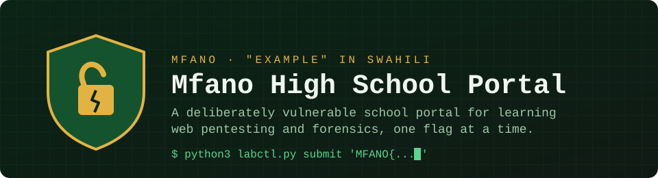

<p align="center">
  
</p>

<p align="center">
  
  
  
  
  
  
  
</p>

> [!CAUTION]
> **This lab has security holes on purpose. Never deploy it on a public server.**
> Run it on your own machine only. If you must reach it from another device, put
> it behind Tailscale or Cloudflare Access so that only you can get in.

**Mfano High School Portal** is a made-up Kenyan secondary school portal. Students
check marks and download report forms, the bursar takes M-Pesa-style fee
payments, and the admin runs the server tools. Hidden inside are web bugs from the
[OWASP Top 10:2025](https://top10.owasp.org/2025/), a few network
misconfigurations, and a box of forensics evidence. Each one gives up a
`MFANO{...}` flag when you exploit it. The flags are scored offline by a small CLI
called `labctl`.

*Mfano* means "example" in Swahili. Every student, mark, fee balance and payment is
fake, and the lab never calls a real payment API.

## Contents

- [What you will practise](#what-you-will-practise)
- [Requirements](#requirements)
- [Install and run](#install-and-run)
  - [Kali Linux / Debian / Ubuntu](#kali-linux--debian--ubuntu)
  - [Windows](#windows)
  - [macOS](#macos)
- [Log in](#log-in)
- [Find and submit flags](#find-and-submit-flags)
- [The challenges](#the-challenges)
- [labctl reference](#labctl-reference)
- [Run the tests](#run-the-tests)
- [Troubleshooting](#troubleshooting)
- [Project layout](#project-layout)
- [Safety rules](#safety-rules)
- [About](#about)

## What you will practise

| Track | Skills |
| ----- | ------ |
| Web | Access control, injection, broken auth and sessions, file upload, SSRF, business logic |
| Linux | Moving around the filesystem of a compromised box |
| Networking | Port and service discovery with `nmap`, weak database credentials |
| Secrets and supply chain | Secrets in frontend code and git history, vulnerable dependencies, leaky errors |
| Cryptography | Cracking weak password hashes, spotting fake "encryption", forging weakly-signed tokens, hardcoded keys, ECB structure leaks |
| Integrity and design | Insecure deserialization, mass assignment, secrets leaking into exposed logs |
| Social engineering | OSINT password profiling, spotting phishing, and pretexting — all against fake NPCs in the lab |
| Forensics | Image metadata, file carving, LSB steganography, GIF frames, Morse, spectrograms, video frames |

## Requirements

| Tool | Needed for | Notes |
| ---- | ---------- | ----- |
| Git | Getting the lab | Any recent version |
| Docker and Docker Compose | The web, network and server challenges | Docker Desktop on Windows or macOS; `docker.io` on Linux |
| Python 3.10 or newer | `labctl` (scoring and helpers) | Uses the standard library only |
| About 2 GB free disk | Docker images | |

You don't need Docker for the forensics track. Python and your usual tools are
enough.

## Install and run

### Kali Linux / Debian / Ubuntu

```sh
# 1. Install Docker and Compose (one time)
sudo apt update
sudo apt install -y git docker.io docker-compose
sudo systemctl enable --now docker
sudo usermod -aG docker "$USER"   # then log out and back in, or run: newgrp docker

# 2. Get the lab
git clone https://github.com/Antech-greyhat/VulnHub.git
cd VulnHub

# 3. Start it
python3 labctl.py start
```

When the containers are up, open <http://127.0.0.1:8080>.

`labctl` uses `docker compose` when that plugin is installed and falls back to the
older `docker-compose` command otherwise, so both Kali packages work.

### Windows

1. Install [Docker Desktop](https://www.docker.com/products/docker-desktop/) with
   the WSL 2 backend, then restart.
2. Install [Git](https://git-scm.com/download/win) and
   [Python 3](https://www.python.org/downloads/).
3. In PowerShell:

   ```powershell
   git clone https://github.com/Antech-greyhat/VulnHub.git
   cd VulnHub
   python labctl.py start
   ```

The repo forces LF line endings, so the container scripts work even when you
clone on Windows.

### macOS

Install Docker Desktop, then:

```sh
git clone https://github.com/Antech-greyhat/VulnHub.git
cd VulnHub
python3 labctl.py start
```

### Stop and reset

```sh
python3 labctl.py stop     # stop the containers
python3 labctl.py reset    # wipe the database and reseed fresh mock data
```

## Log in

| Role | Username | Password |
| ---- | -------- | -------- |
| Student | `MHS1007` | `Student@123` |
| Admin | `admin` | `Mfano@Admin2026` |

Every student from `MHS1001` to `MHS1030` uses the same demo password. The admin
login is there so you can look around. Hacking your way to admin from a student
account counts for more.

## Find and submit flags

Every flag is the word `MFANO`, then short words in **leetspeak** inside curly
braces, joined by underscores:

```text
MFANO{c4n_h4ck_f0r_r34l}
```

| Plain letter | a | e | i | o | s (sometimes) |
| ------------ | - | - | - | - | ------------- |
| In a flag | `4` | `3` | `1` | `0` | `5` |

Copy a flag exactly as you find it. Don't translate it back to plain English. A
plain-English guess like `MFANO{can_hack_for_real}` will always print
`wrong flag`.

1. **Hunt.** Exploit a bug in the portal, or pull a secret out of a forensics
   file. A real exploit makes the flag show up: in a page, a database row, a
   file on the box, a frame of video.
2. **Submit.** Run this from the repo folder. Use single quotes so your shell
   leaves the braces alone:

   ```sh
   python3 labctl.py submit 'MFANO{c4n_h4ck_f0r_r34l}'
   ```

   ```text
   Correct! Stage P1-01 solved (A01 Broken Access Control, Easy).
   Next stage: P1-02 (A01 Broken Access Control, Easy)
   ```

   A wrong flag prints `wrong flag`. Submitting the same flag again won't
   count it twice.
3. **Track progress.**

   ```sh
   python3 labctl.py status
   ```

   ```text
   Stage   OWASP 2025 category                         Difficulty    Status
   P1-01   A01 Broken Access Control                   Easy          solved
   P1-02   A01 Broken Access Control                   Easy          -
   ...
   1 / 35 solved
   ```

How scoring works:

- `flags.sha256` holds only the **SHA-256 hash** of each flag. `labctl` hashes what
  you submit and compares the two, so reading the repo won't give you the answers.
- Your progress is saved in `.labprogress.json` in the repo folder. Git ignores
  that file. Delete it to start over.
- Flags found in pictures, audio or video are drawn or spoken in capitals, for
  example `MFANO{C4N_H4CK}`. Keep `MFANO` in capitals, but write the part inside
  the braces in **lowercase** and keep the digits: `MFANO{c4n_h4ck}`. In the
  pixel font, a zero has a slash through it and a one has a hook at the top.

## The challenges

There are 35 flags. The categories are listed below, but not where the bugs are.
`SCOREBOARD.md` has the per-phase breakdown.

| Stages | Theme | Count | Difficulty |
| ------ | ----- | ----- | ---------- |
| P1-xx | Web access control and Linux files | 3 | Easy |
| P2-xx | Networking and exposed services | 2 | Easy-Medium |
| P3-xx | Injection, XSS, sessions, privilege escalation | 4 | Medium |
| P4-xx | Server tools: chains that end in full control | 4 | Hard |
| P5-xx | Secrets, supply chain and error handling | 4 | Medium-Hard |
| P5B-xx | Weak cryptography: hashes, fake encryption, tokens, keys, ECB | 5 | Medium-Hard |
| P5D-xx | Integrity and design: deserialization, mass assignment, logged secrets | 3 | Medium |
| SE-xx | Social engineering: OSINT, phishing, pretexting (fake NPCs) | 3 | Easy-Medium |
| F-xx | Forensics: images, GIF, audio, video | 7 | Easy to Medium |

<details>
<summary><b>Networking notes</b></summary>

The lab publishes a few services on your loopback interface only:

```sh
nmap -sV 127.0.0.1
```

| Port | Service |
| ---- | ------- |
| 8080 | Web portal (Flask) |
| 5432 | PostgreSQL "results backup" database |

A small internal grading service also runs inside the Docker network. It isn't
published to your machine, so `nmap` from the host won't see it. Reaching it is
a later challenge.

</details>

<details>
<summary><b>Supply-chain notes</b></summary>

One dependency is pinned to an old, known-vulnerable version on purpose. The
lesson is **detection**: find it, read the advisory, note the fixed version.

```sh
# Kali blocks system-wide pip installs, so use pipx or a virtualenv
sudo apt install -y pipx && pipx install pip-audit
python3 labctl.py audit
```

Never run an exploit against an external target.

</details>

<details>
<summary><b>Cryptography notes</b></summary>

Five challenges live on the running portal and each one is solved by **breaking**
the crypto, not by reading the source. You will want a wordlist and a few common
tools (all on Kali):

```sh
# password-hash and JWT-secret cracking
sudo apt install -y hashcat john
ls /usr/share/wordlists/rockyou.txt.gz && gunzip -k /usr/share/wordlists/rockyou.txt.gz
# base64 / AES by hand: CyberChef, or openssl / python / node one-liners
```

The lessons: encoding is not encryption, a key shipped to the browser is not a
secret, a guessable signing secret is forgeable, unsalted hashes fall to a
wordlist, and ECB mode leaks the structure of what it encrypts.

</details>

<details>
<summary><b>Social-engineering notes</b></summary>

Three awareness challenges live on the staff **Intranet** (in the student nav,
or `/intranet`). They are a safe sandbox:

- **Everyone is a fake NPC.** No real people, companies or brands.
- **Nothing sends a real message.** The webmail items are static samples and the
  helpdesk "bot" is a rule-based script that talks to nothing outside the lab.
- **No working phishing page, no credential capture.** You never type a real
  password anywhere; the fake sign-in only checks an invented NPC account.

What you practise: reading a person's public posts to profile a weak password
(OSINT), telling phishing from legitimate mail by sender/link/pressure, and
chaining small facts into a convincing pretext. No tools needed beyond the browser.

</details>

<details>
<summary><b>Forensics notes</b></summary>

The [`forensics/`](forensics/) folder holds seven evidence files from a leaked
mock exam. You don't need Docker for these. Read the case brief in
[`forensics/README.md`](forensics/README.md). On Kali, most of the tools are
already installed or one `apt install` away:

```sh
sudo apt install -y exiftool binwalk foremost ffmpeg audacity sonic-visualiser
sudo apt install -y ruby && sudo gem install zsteg
```

</details>

## labctl reference

| Command | What it does |
| ------- | ------------ |
| `python3 labctl.py start` | Build and start the lab containers in the background |
| `python3 labctl.py stop` | Stop the containers |
| `python3 labctl.py reset` | Rebuild the database with fresh mock data |
| `python3 labctl.py shell` | Open a shell inside the web container |
| `python3 labctl.py audit` | Scan `requirements.txt` with pip-audit |
| `python3 labctl.py submit '<flag>'` | Check a flag and record it |
| `python3 labctl.py status` | Show every stage and your progress (`score` does the same) |

On Windows, use `python` in place of `python3`.

## Run the tests

The tests check that the lab is built correctly. They **contain every flag**,
so read them only after you finish.

```sh
python3 -m venv .venv
. .venv/bin/activate            # Windows: .venv\Scripts\activate
pip install -r requirements.txt pytest
python -m pytest -q
```

## Troubleshooting

| Problem | Fix |
| ------- | --- |
| `permission denied ... docker.sock` | Add yourself to the `docker` group (see the Kali steps), then log in again |
| `Docker Compose was not found` | `sudo apt install -y docker-compose`, or install Docker Desktop |
| Port 8080 or 5432 already in use | Stop whatever is using it (`sudo ss -ltnp \| grep 8080`) or change the left-hand port in `docker-compose.yml` |
| `error: externally-managed-environment` on `pip install` | Use `pipx` or a virtualenv, as shown above |
| The portal looks broken after you experiment | `python3 labctl.py reset`, or `stop` then `start` to rebuild the containers |
| You want to start the scoring over | Delete `.labprogress.json` |
| A flag you found prints `wrong flag` after you ran `git pull` | The lab still has old data. Rebuild it: `docker compose down -v` (or `docker-compose down -v`), then `python3 labctl.py start` |

## Project layout

```text
.
├── portal/            Flask app: routes, templates, static files
├── services/          Extra containers: grading service, backup database
├── forensics/         Offline forensics evidence and case brief
├── docker/            Container entrypoint
├── tests/             Build checks (spoilers)
├── docs/.internal/    Maintainer notes and the answer key (spoilers)
├── labctl.py          Start, stop, reset, audit, submit, status
├── seed.py            Generates the fake school data
├── flags.sha256       Flag hashes only
└── SCOREBOARD.md      Bug count per OWASP category
```

> [!WARNING]
> **Spoilers live in `tests/` and `docs/.internal/`.** The answer key, the
> forensics generator and every plaintext flag are in there. Stay out until
> you're done, or until you're really stuck.

## Safety rules

- Only attack **this lab, on your own machine**. Never scan or exploit hosts,
  networks or services you don't own or don't have written permission to test.
- The compose file binds every port to `127.0.0.1`. Keep it that way.
- The admin "server tools" can run commands and fetch URLs from the lab box. That
  is part of the lesson, and it's why the lab must never be public.
- See [`SECURITY.md`](SECURITY.md) for what counts as a real issue in this repo.

## About

Built as a hands-on learning project with AI coding agents. Writeups and a
patched version of the portal are planned, so you can compare the vulnerable
`main` branch with the fixed one.

Found a challenge that won't solve, or a flag that won't score? Open an issue
with the **Broken challenge** template. Please don't post the flag itself.
